# C1. Os libros en HDFS

Descargáronse os tres libros do Proxecto Gutenberg en formato texto plano UTF-8 utilizando `wget`. Para realizar as descargas empregouse un mirror alternativo (`gutenberg.pglaf.org`), xa que o servidor principal devolvía un erro HTTP 503.

Os libros descargados foron:

- `pg2000.txt`: Don Quixote.
- `pg2701.txt`: Moby Dick.
- `pg1342.txt`: Pride and Prejudice.

Posteriormente, creouse o directorio `e6/libros` en HDFS e subíronse os tres ficheiros mediante os seguintes comandos:

```bash
hdfs dfs -mkdir -p e6/libros
hdfs dfs -put pg*.txt e6/libros/
hdfs dfs -ls -h e6/libros/
```

### Tamaño dos ficheiros

Segundo a saída de `hdfs dfs -ls -h e6/libros/`, os tamaños dos libros son:

| Ficheiro | Libro | Tamaño |
|---|---|---:|
| pg2000.txt | Don Quixote | 2,1 MB |
| pg2701.txt | Moby Dick | 1,2 MB |
| pg1342.txt | Pride and Prejudice | 754,3 KB |

### Número de bloques e tarefas MAP esperadas

HDFS utiliza bloques de 128 MB. Como os tres ficheiros teñen un tamaño inferior a 128 MB, cada un ocupa un único bloque.

Polo tanto:

- Don Quixote: 1 bloque.
- Moby Dick: 1 bloque.
- Pride and Prejudice: 1 bloque.

En total, os tres libros ocupan 3 bloques HDFS.

No seguinte apartado, ao executar WordCount, espéranse inicialmente 3 tarefas MAP, unha por cada ficheiro, xa que cada un ocupa un único bloque.

## C2. Execución de WordCount con Hadoop

### 1. Execución do traballo MapReduce

Executamos o exemplo WordCount incluído en Hadoop sobre os tres libros almacenados no directorio `e6/libros` de HDFS. O resultado gardouse no directorio `e6/palabras`.

Para executar o programa utilizamos o seguinte comando:

```bash
yarn jar $EX wordcount e6/libros e6/palabras
```

Hadoop identificou os tres ficheiros de entrada e creou tres divisións (*input splits*), unha por cada ficheiro. O traballo rematou correctamente.

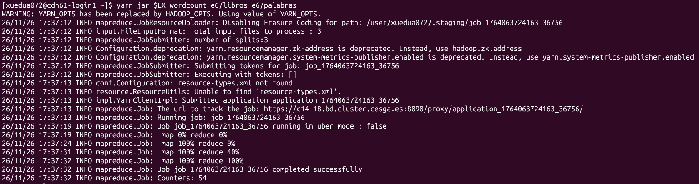

### 2. Análise dos contadores de MapReduce

Ao finalizar a execución, Hadoop mostrou os contadores do traballo. Os valores máis relevantes son:

| Contador | Valor |
|---|---:|
| Launched map tasks | 3 |
| Launched reduce tasks | 48 |
| Map input records | 75.303 |
| Map output records | 735.917 |
| Combine input records | 735.917 |
| Combine output records | 88.024 |
| Reduce input records | 88.024 |
| Reduce output records | 79.998 |

A interpretación destes resultados é a seguinte:

- **Map tasks:** executáronse 3 tarefas Map, correspondentes ás tres divisións de entrada.
- **Reduce tasks:** executáronse 48 tarefas Reduce.
- **Map input records:** o Mapper procesou 75.303 rexistros de entrada.
- **Map output records:** o Mapper xerou 735.917 rexistros intermedios, correspondentes aos pares palabra-contador.
- **Reduce output records:** obtivéronse 79.998 rexistros finais, correspondentes ás distintas claves (palabras e variantes) contabilizadas.

Tamén se observa que Hadoop empregou un *Combiner*, que reduciu os rexistros intermedios de 735.917 a 88.024 antes de envialos á fase Reduce. Isto permite reducir a cantidade de datos transferidos durante a fase de *Shuffle*.

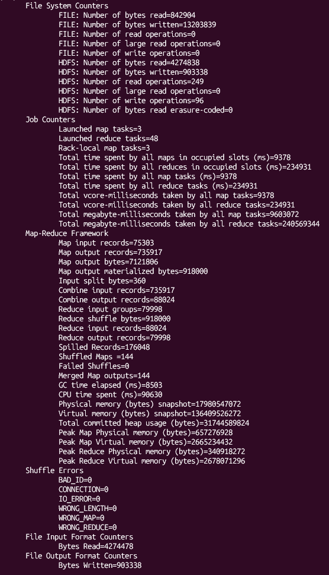

### 3. Ficheiros xerados e palabras máis frecuentes

Consultamos o contido do directorio de saída:

```bash
hdfs dfs -ls e6/palabras
```

Obtivéronse 49 elementos: un ficheiro `_SUCCESS` e 48 ficheiros `part-r-xxxxx`, un por cada tarefa Reduce.

O ficheiro `_SUCCESS` indica que o traballo finalizou correctamente. Os ficheiros `part-r-xxxxx` conteñen os resultados xerados polos reducers.

Para obter as 20 palabras máis frecuentes utilizamos:

```bash
hdfs dfs -cat e6/palabras/part-* | sort -t$'\t' -k2 -nr | head -20
```

Os resultados foron:

| Palabra | Frecuencia |
|---|---:|
| que | 19.546 |
| the | 18.539 |
| de | 18.195 |
| a | 16.197 |
| y | 15.976 |
| of | 10.652 |
| la | 10.331 |
| and | 9.508 |
| to | 8.878 |
| el | 8.009 |
| en | 7.941 |
| no | 6.513 |
| in | 5.891 |
| se | 4.751 |
| los | 4.701 |
| that | 4.161 |
| con | 4.119 |
| por | 3.763 |
| his | 3.624 |
| I | 3.487 |

Obsérvase que aparecen palabras en inglés e español, xa que os libros procesados están escritos neses idiomas.

### 4. Análise das variantes da palabra «whale»

Para comprobar como WordCount trata as diferentes formas dunha palabra, executamos:

```bash
hdfs dfs -cat e6/palabras/part-* | grep -i whale
```

Na saída aparecen numerosas variantes, por exemplo:

| Variante | Frecuencia |
|---|---:|
| whale | 393 |
| whale, | 172 |
| Whale | 138 |
| whales | 134 |
| whale’s | 76 |
| whale. | 58 |
| Whale’s | 46 |
| Whale; | 29 |
| whales. | 22 |
| Whale. | 17 |

Isto débese a que o WordCount estándar de Hadoop separa as palabras utilizando os espazos en branco, pero non elimina os signos de puntuación nin normaliza o texto.

Polo tanto, distingue entre maiúsculas e minúsculas, signos de puntuación, plurais e outras variacións. Cada cadea diferente considérase unha clave independente e contabilízase por separado.

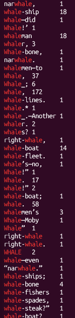

### 5. Repetición da execución

Finalmente, intentamos executar de novo o mesmo comando:

```bash
yarn jar $EX wordcount e6/libros e6/palabras
```

Nesta ocasión Hadoop devolveu o erro:

```text
org.apache.hadoop.mapred.FileAlreadyExistsException:
Output directory .../e6/palabras already exists
```

Isto sucede porque Hadoop non permite utilizar un directorio de saída que xa existe, para evitar sobrescribir ou mesturar resultados de execucións anteriores.

Se queremos repetir o traballo, primeiro debemos eliminar o directorio de saída:

```bash
hdfs dfs -rm -r e6/palabras
```

E despois executar novamente o comando WordCount.

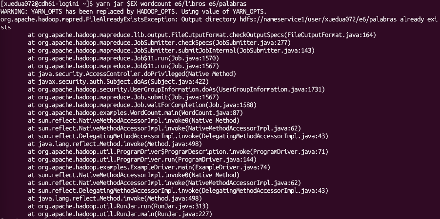

**Conclusión:** mediante este exercicio executamos un traballo MapReduce sobre tres ficheiros de texto, analizamos os contadores das fases Map e Reduce, identificamos as palabras máis frecuentes e comprobamos como Hadoop trata as diferentes variantes dunha mesma palabra. Tamén verificamos que é necesario eliminar o directorio de saída antes de repetir unha execución.

## C3. Compras por bar con MapReduce

Xerouse o ficheiro `compras.csv` con 90.000 compras mediante `xera_compras.py`. Antes de executalo no clúster, comprobouse localmente o funcionamento do Mapper e do Reducer:

```bash
cat compras.csv | python mapper_compras.py | sort | python reducer_suma.py
```

Obtivéronse os seguintes resultados:

| Bar | Compras |
|---|---:|
| Escenario | 26.896 |
| Norte | 22.646 |
| Praia | 31.350 |
| VIP | 9.108 |

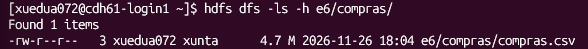

A continuación, executouse o traballo con Hadoop Streaming sobre o ficheiro `e6/compras/compras.csv`, gardando a saída en `e6/resultados_compras`.

O traballo rematou correctamente. Executáronse 2 tarefas Map e 48 Reduce. O Mapper recibiu 90.001 rexistros e emitiu 90.000; o Reducer procesou 4 grupos e xerou 4 resultados.

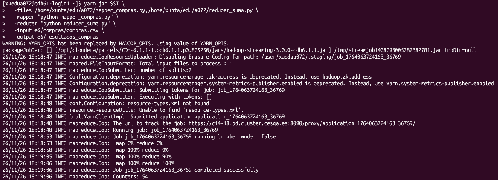

Os contadores do sistema de ficheiros indican que se leron 4.937.652 bytes de HDFS e se escribiron 49 bytes.

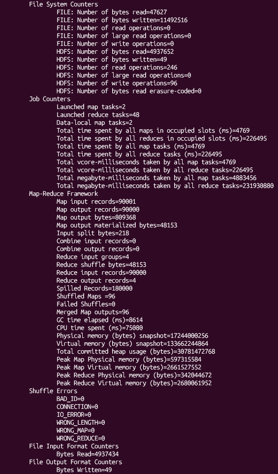

Finalmente, consultáronse os ficheiros de saída en HDFS. Aínda que se crearon 48 ficheiros `part-*`, só catro conteñen resultados, correspondentes aos catro bares. O ficheiro `_SUCCESS` confirma que o traballo rematou correctamente.

Os resultados coinciden cos da proba local:

```text
VIP         9108
Norte       22646
Escenario   26896
Praia       31350
```

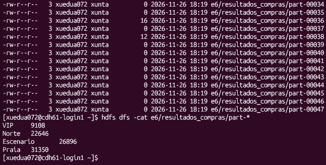

### Cuestións

#### 1. O resultado: compras de cada barra. Suman o total de compras do ficheiro? Compara Map input records e Map output records co número de liñas de compras.csv (wc -l): por que non coinciden os tres?

As compras por bar suman 90.000, que coincide co número total de compras do ficheiro.

En cambio, `wc -l compras.csv` devolve 90.001 liñas, igual que Map input records. Isto ocorre porque se conta a liña da cabeceira tanto en Map Input record como en `wc -l compras.csv`, algo que o Map Output record non fai xa. 

Polo tanto, hai 90.000 compras reais e unha liña de cabeceira.

#### 2. Que fai a liña if len(campos) != 7 or campos[0] == "compra_id" do mapper? Que pasaría sen ela?

Comproba, para cada liña, se ten 7 campos ou se é a primeira liña, a da cabeceira, que sería `campos[0]`. 

Se unha liña non ten 7 campos ou é a cabeceira, aplícase un continue no parseo e pasamos á seguinte liña

Se unha liña non reúne estas condicións de descarte, procésase a compra e xérase unha saída co nome da barra correspondente.

#### 3. Por que o reducer pode supoñer que todas as liñas dunha barra lle chegan seguidas? Quen as ordena no clúster?

A fase de Shuffle and Sort de Hadoop ordena os pares calve valor das palabras, polo que a lista resultante ten todas as palabras iguais agrupadas. Esta configuración é a que chega aos Reducers e por iso todas as compras dunha barra chegan ao mesmo Reducer.

#### 4.  Cantos ficheiros part- hai en e6/barras e cantos teñen datos? Por que? Podes ver os tamaños con hdfs dfs -ls e6/barras e contar os que non están baleiros con hdfs dfs -ls e6/barras/part-* | awk '$5 > 0' | wc -l.

En e6/resultados_compras hai 48 ficheiros part-*, dos cales só 4 teñen datos. Isto débese a que o clúster executou 48 tarefas Reduce, pero só había catro barras distintas. Os outros 44 ficheiros están baleiros.

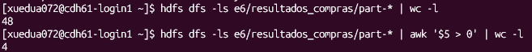

A captura confirma estes datos: o primeiro comando conta os 48 ficheiros `part-*` xerados e o segundo conta os 4 que teñen un tamaño maior que cero, é dicir, os que conteñen resultados.

## C4. Suma dos importes por barra

Modificouse o mapper de C3 para crear `mapper_importes.py`. Mantívose a lectura do CSV e a comprobación das liñas, pero cambiouse o valor emitido: en lugar de enviar `1` por cada compra, envíase o importe da columna `campos[6]`.

```python
barra = campos[2]
importe = campos[6]
print("%s\t%s" % (barra, importe))
```

A proba local produciu os seguintes resultados:

```text
Escenario 184230.50
Norte 155114.50
Praia 212840.50
VIP 62176.00
```

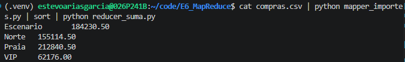

Executouse tamén o traballo con Hadoop Streaming no clúster, utilizando o mesmo `reducer_suma.py` de C3, sen modificalo. A execución rematou correctamente, procesando 90.000 compras.

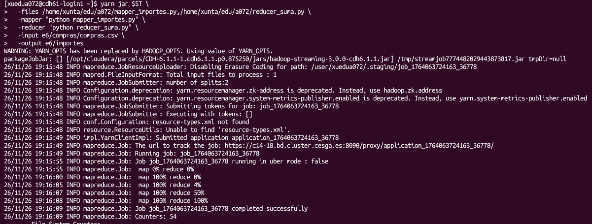

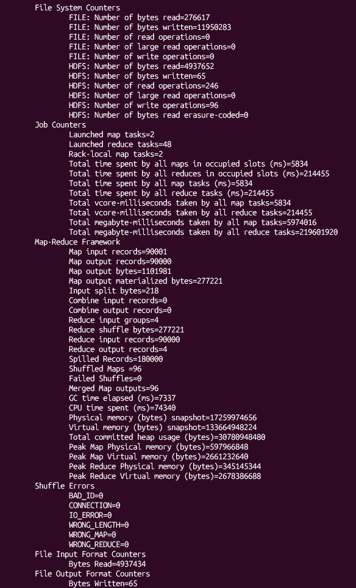

Os resultados obtidos en HDFS foron os seguintes:

```text
VIP        62176.00
Norte     155114.50
Escenario 184230.50
Praia     212840.50
```

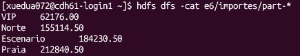

#### 3. Por que vale o mesmo reducer para contar compras e para sumar importes?

O mesmo reducer serve para contar compras e sumar importes porque simplemente suma os valores asociados a cada barra. Se o mapper envía `1`, o resultado é o número de compras; se envía o importe, o resultado é a suma dos cartos.

#### 4.  O reducer usa Decimal en lugar de float. Proba a sumar en Python 0.1 + 0.2: por que importa isto cando se suman cartos?

**Uso de Decimal:** ao probar `0.1 + 0.2` en Python, `repr()` amosou `0.30000000000000004`, aínda que `print()` amosaba `0.3`, como podemos ver na seguinte captura. Sen embargo, o valor real que garda float en memoria é `0.30000000000000004`.

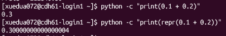

Isto débese ás aproximacións na representación binaria dos números `float`. Para traballar con cartos é importante evitar estes erros de precisión, polo que o reducer utiliza `Decimal`, que permite realizar operacións decimais exactas.

Na seguinte captura facemos un print de 0.1 + 0.2 usando a biblioteca Decimal e comparámolo con float. Vemos que se aprecia esa diferenza.

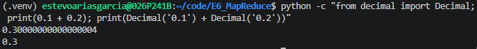